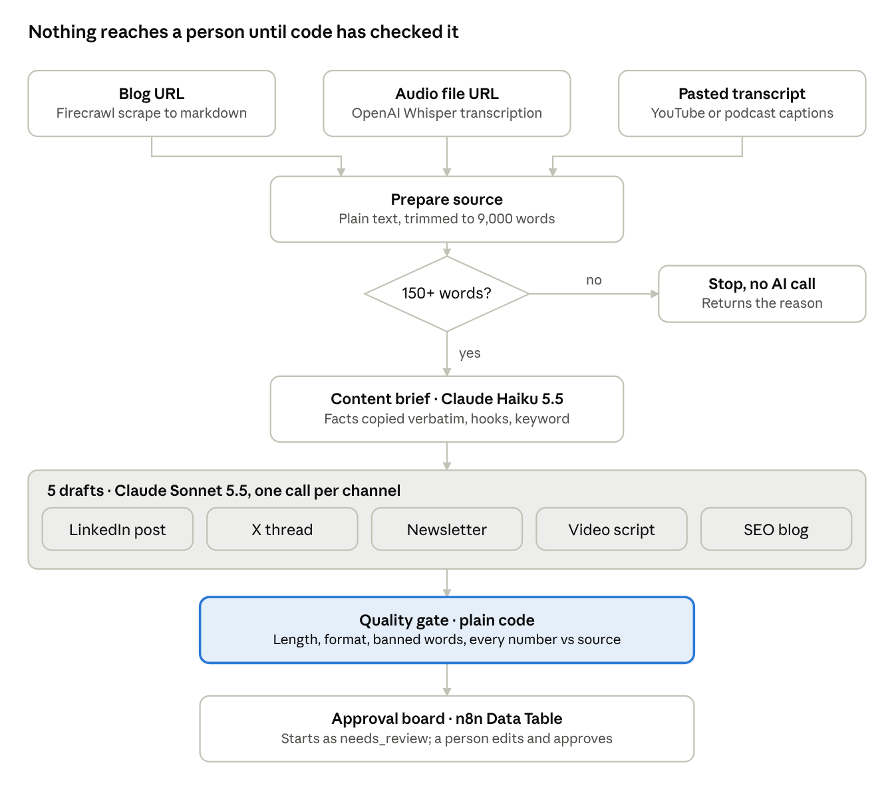
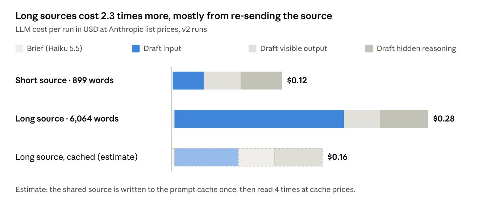

# AI Content Engine

One long-form source in, five channel-ready drafts out, and nothing reaches a person until code has checked it.

An n8n workflow that takes a blog URL, an audio file or a pasted transcript and writes a LinkedIn post, an X thread, a newsletter section, a 45 to 60 second video script and an SEO blog draft. A quality gate written in plain JavaScript checks every draft, then each one lands on an approval board as `needs_review`. Nothing posts automatically.

**Read the full case study:** [`assets/AI-Content-Engine-Case-Study.pdf`](assets/AI-Content-Engine-Case-Study.pdf) · **Watch the 60-second demo:** [`assets/AI-Content-Engine-demo.mp4`](assets/AI-Content-Engine-demo.mp4) · **Carousel:** [`assets/AI-Content-Engine-carousel.pdf`](assets/AI-Content-Engine-carousel.pdf)



## Results (real runs, November 1, 2026)

| Run | Version | Source | Time | Gate pass | LLM cost* |
| --- | --- | --- | --- | --- | --- |
| 1 | v1 | 899-word article, pasted | 72 s | 3 of 5 | $0.12 |
| 2 | v1 | 6,064-word GitLab Handbook page, by URL | 88 s | 4 of 5 | not split in v1 logs |
| 3 | v1 | 28-second public-domain audio clip | 2.5 s | stopped by guard (67 words) | $0 |
| 4 | v2 | 899-word article, pasted | 67.5 s | 4 of 5 | $0.12 |
| 5 | v2 | 6,064-word GitLab Handbook page, by URL | 81 s | 4 of 5 | $0.28 |
| 6 | v2 | 630-word results write-up (dogfood) | 71 s | 0 of 5, gate bug | $0.12 |
| 7 | v3 | 630-word results write-up (dogfood) | 75 s | 4 of 5 | $0.13 |

\* Logged tokens × [Anthropic list prices](https://platform.claude.com/docs/en/about-claude/pricing). Runs used n8n AI credits.

- Test set (runs 1, 2, 4, 5): **15 of 20 drafts passed first time**, **0** drafts used a number that was not in the source.
- The gate caught an X post at 281 characters after the prompt asked for under 270.
- More than half of draft output tokens were hidden reasoning (53% and 57% on runs 4 and 5).
- Long sources cost 2.3× more because each of the five draft calls re-sends the source (92k input tokens). Caching the shared source is estimated to bring that run from $0.28 to $0.16.
- The published LinkedIn post for this project is run 7's draft with 20.3% of words changed (`post/`).
- Run 7's one flag was an edge case: the video script shows `[CHECK: real timing and pass-rate numbers]` on screen as a quote. Text rules cannot read intent, which is why a person still approves every draft.



Full run data: [`results/runs.json`](results/runs.json).

## Two bugs testing found

1. **The brief ran out of room (v1).** Claude Haiku 5.5 spent 1,210 of a 2,000-token budget on hidden reasoning, so the JSON brief was truncated. Nothing crashed: the SEO draft wrote `[CHECK: seo_keyword missing from brief]` and the gate flagged it. Fix in v2: budget raised to 8,000 tokens; reasoning tokens, stop reason and brief parsing are now logged.
2. **The gate was too strict (v2).** When the engine repurposed its own results write-up, all five drafts were flagged because they quoted the phrase "[CHECK] note". Fix in v3: the gate matches only real placeholders (`[CHECK:`), with a unit test.

## Repository

```
workflow/
  ai-content-engine.n8n.json   n8n export (no credentials, no instance IDs)
  quality_gate.js              the Quality Gate Code node, as deployed
  plan_channel_jobs.js         builds the five channel prompts from the brief
  run_summary.js               per-run token and gate summary
tests/
  quality_gate.test.js         runs the gate code against synthetic drafts
prompts/
  prompts.md                   brief prompt, draft rules, channel specs
results/
  runs.json                    every run: timing, tokens, gate results
  source_*.md                  the two sources I wrote and fed in
post/
  engine_draft_run11.txt       the LinkedIn draft the engine wrote
  linkedin_post_final.txt      what I published
assets/                        case study PDF, demo video, carousel, architecture diagram, cost chart
```

## Run it yourself

1. **Import** `workflow/ai-content-engine.n8n.json` into n8n (Workflows → Import from file).
2. **Credentials:** add Anthropic (Build Content Brief, Write Channel Draft), OpenAI (Transcribe Audio) and Firecrawl (Scrape Blog Post), or use n8n AI credits where offered. Note: on n8n AI credits, Claude Sonnet 4.5 and Haiku 4.5 were rejected; Sonnet 5.5 and Haiku 5.5 worked.
3. **Approval board:** create an n8n Data Table named `Content Engine Approval Board` with columns `run_id`, `source_title`, `source_type`, `channel`, `draft`, `gate_notes`, `status`, `final_text`, `model` (string), `word_count`, `input_tokens`, `output_tokens`, `thinking_tokens` (number) and `gate_passed` (boolean). Select it in the **Save to Approval Board** node.
4. **Run** the form in test mode, paste a transcript of at least 150 words, and watch five rows appear on the board.
5. **Before publishing the form,** add authentication to the Form Trigger. A public form lets anyone spend your AI budget.

Run the gate tests (Node 18+):

```
node tests/quality_gate.test.js
```

## Design decisions

- **Brief first, then one call per channel.** Every draft shares one reading of the source, and one failed draft never takes the others down. It costs more input tokens; the cost chart shows how much.
- **Rules in code, not just in prompts.** Prompt limits are set tighter than gate limits: the prompt aims, the gate catches.
- **An honest gap beats a confident guess.** Drafts write `[CHECK: ...]` when something is missing, and the gate surfaces it.
- **Human approval by default.** Auto-posting is a better demo and a worse product.
- **Deliberately left out:** direct YouTube download (fragile, terms-of-service grey area; paste the transcript), auto-posting, image generation, a public form.

## Test sources and licences

- My own article (`results/source_build_log.md`) and results write-up (`results/source_results_writeup.md`).
- [GitLab Handbook: Product Management](https://handbook.gitlab.com/handbook/product/product-management/), CC BY-SA 4.0, used as test input only.
- [JFK Rice University speech excerpt](https://www.w3.org/WAI/content-assets/wcag-act-rules/test-assets/moon-audio/moon-speech.mp3), public domain, via the W3C ACT rules test assets.
